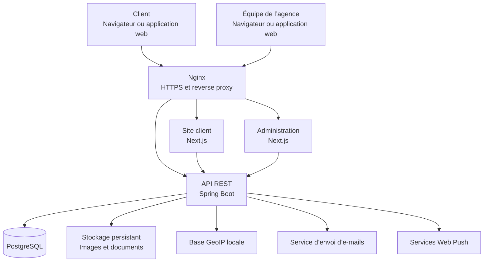
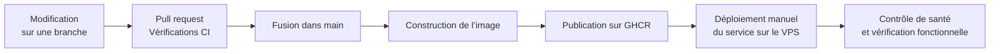
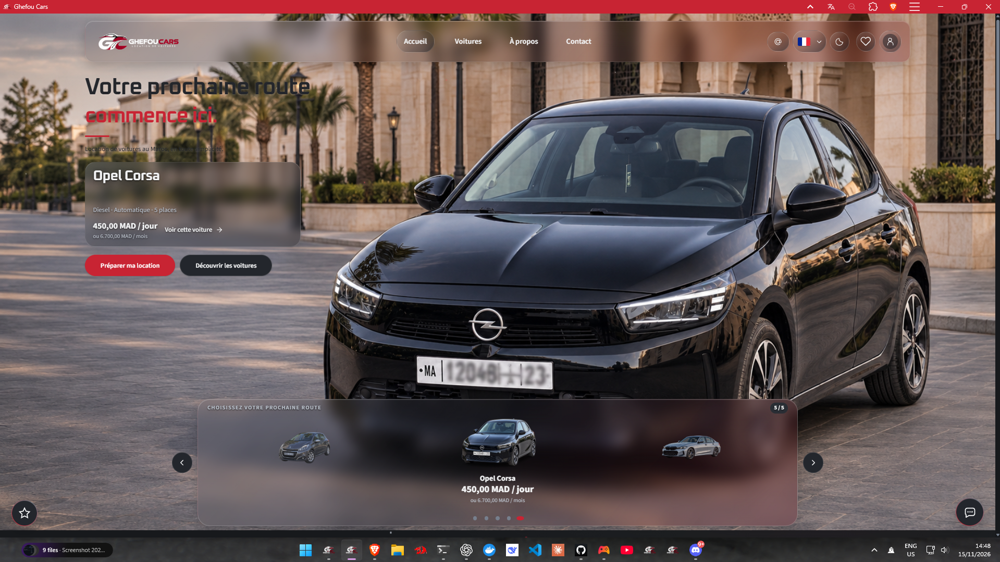
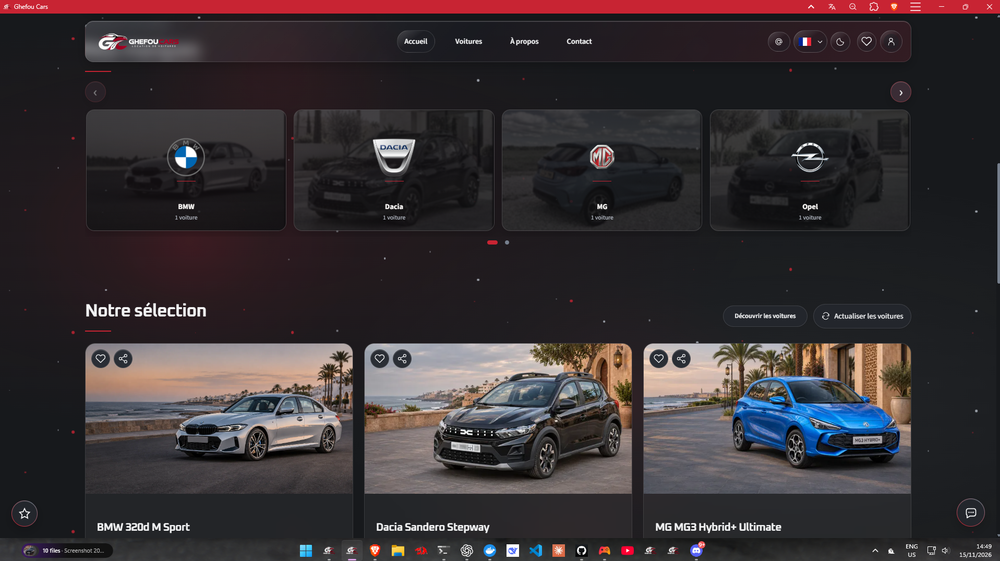
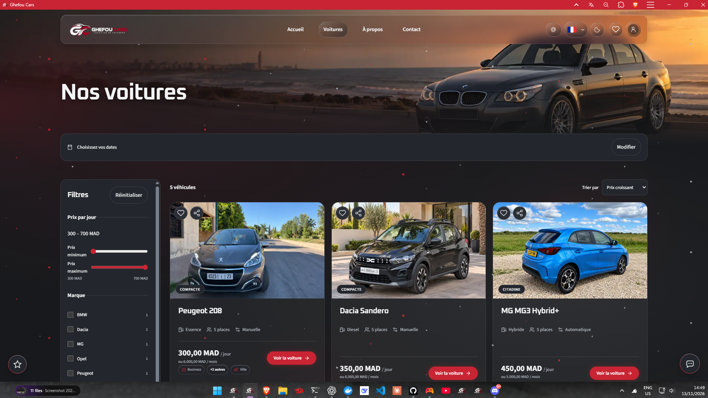
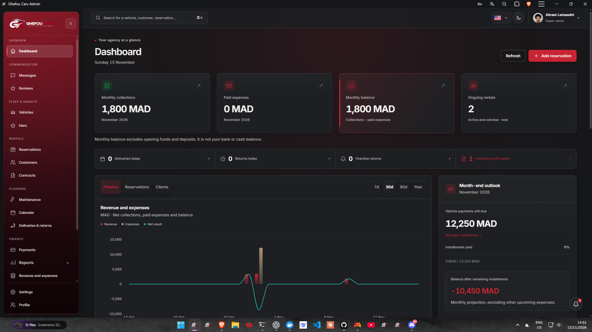
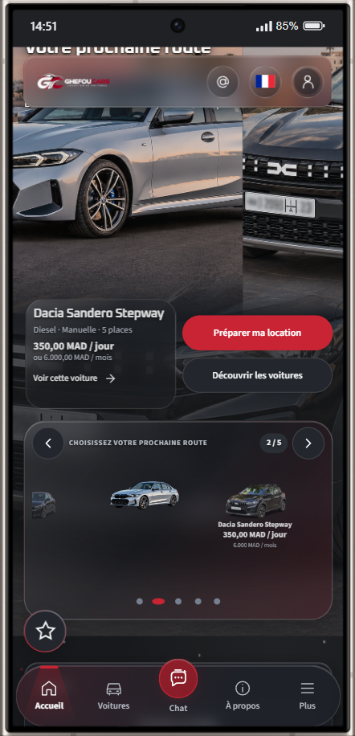

<div align="center">

# Ghefou Cars
### Plateforme de location automobile

**Site client multilingue · Application d’administration · API REST**

Projet freelance conçu, développé et déployé pour une agence de location automobile au Maroc.


[Présentation](#présentation) ·
[Fonctionnalités](#fonctionnalités) ·
[Architecture](#architecture) ·
[Captures](#captures-décran) ·
[Déploiement](#déploiement-et-livraison) ·
[Contribution](#ma-contribution)

</div>

---

## Présentation

**Ghefou Cars** est une plateforme web destinée à centraliser la présence en ligne et les opérations quotidiennes d’une agence de location automobile.

Elle associe trois applications complémentaires :

- Un **site client** pour découvrir les véhicules, envoyer une demande de réservation et échanger avec l’agence.
- Une **application d’administration** pour gérer le parc automobile, les clients, les réservations et le suivi de l’activité.
- Une **API REST** qui centralise les règles métier, l’authentification et l’accès aux données.

Le projet couvre le cycle de réalisation d’une application web : analyse des besoins, conception, développement, intégration et mise en production.

> Ce dépôt présente le projet, son architecture et des captures de ses interfaces. Le code source de l’application reste privé.

## Contexte et objectifs

| Élément | Description |
|:--|:--|
| Nature | Projet freelance |
| Domaine | Location automobile |
| Localisation de l’agence | Meknès, Maroc |
| Rôle | Développeur Full Stack & DevOps |
| État | Déployé en production |
| Supports | Ordinateur, tablette et téléphone |
| Langues du site client | Français, anglais et arabe |
| Code source | Privé |

La plateforme répond à plusieurs besoins :

- Présenter les véhicules et leurs caractéristiques dans un catalogue accessible.
- Structurer les demandes de réservation.
- Centraliser les informations clients et le suivi des locations.
- Faciliter les échanges entre les clients et l’agence.
- Donner à l’équipe une vue d’ensemble de son activité.
- Permettre la livraison de nouvelles versions avec des images Docker identifiées précisément.

## Fonctionnalités

### Site client

#### Catalogue automobile

- Consultation du parc automobile.
- Recherche et filtrage des véhicules.
- Fiches détaillées avec caractéristiques et galeries d’images.
- Sélection d’une période de location.
- Gestion des véhicules favoris depuis un compte client.

#### Demandes de réservation

- Parcours de réservation en plusieurs étapes.
- Sélection des dates et des horaires.
- Saisie des informations nécessaires à la demande.
- Récapitulatif avant envoi.
- Consultation des réservations dans l’espace personnel.

Les demandes sont ensuite traitées par l’agence selon son processus de validation.

#### Compte et authentification

- Inscription et connexion par e-mail et mot de passe.
- Connexion avec Google.
- Vérification de l’adresse e-mail.
- Récupération et modification du mot de passe.
- Gestion du profil, des coordonnées et de la photo de compte.

#### Communication et avis

- Messagerie entre le client et l’agence.
- Accès aux moyens de contact de l’agence.
- Publication de notes et d’avis.
- Notifications Web Push sur les appareils compatibles, après autorisation de l’utilisateur.
- Gestion des appareils enregistrés pour les notifications.

#### Expérience utilisateur

- Interface responsive.
- Traductions en français, anglais et arabe.
- Prise en charge de l’affichage de droite à gauche pour l’arabe.
- Thèmes clair et sombre.
- Installation comme application web sur les navigateurs compatibles.
- Images adaptées aux différentes tailles d’écran et utilisation du format WebP.

### Application d’administration

#### Gestion du parc automobile

- Création, modification et gestion des véhicules.
- Gestion des caractéristiques et des images.
- Activation ou désactivation de véhicules dans le catalogue.
- Personnalisation des véhicules et visuels présentés dans la section principale du site.

#### Gestion des locations

- Consultation et traitement des demandes de réservation.
- Gestion des dossiers clients.
- Suivi des contrats et des paiements.
- Organisation des remises et des retours de véhicules.
- Consultation du calendrier d’activité.
- Suivi de la maintenance du parc.

#### Suivi de l’activité

- Tableau de bord.
- Suivi des revenus et des dépenses.
- Rapports et graphiques de synthèse.
- Statistiques de fréquentation du site client : visiteurs, sessions, pages vues et durée active.
- Répartition des visiteurs par pays à partir d’une base GeoIP.

> La détection du pays repose sur l’adresse IP. Elle reste approximative et peut être influencée par un VPN, un proxy ou le réseau utilisé.

#### Communication et configuration

- Gestion des conversations clients.
- Modération des avis.
- Notifications et gestion des appareils.
- Gestion des utilisateurs et des droits d’accès.
- Configuration des informations publiques de l’agence.

## Technologies

| Domaine | Technologies et outils |
|:--|:--|
| Backend | Java 21, Spring Boot, Spring Security |
| Accès aux données | Spring Data JPA, Hibernate |
| Base de données | PostgreSQL |
| Migrations | Flyway |
| Frontend client | Next.js, React, TypeScript |
| Frontend administration | Next.js, React, TypeScript |
| Interfaces | Tailwind CSS, composants partagés, Lucide |
| Authentification | JWT, connexion Google |
| Communication en temps réel | Server-Sent Events — SSE |
| Notifications | Web Push, Service Workers, VAPID |
| Géolocalisation IP | GeoLite2 Country |
| Conteneurisation | Docker, Docker Compose |
| Intégration continue | GitHub Actions |
| Registre d’images | GitHub Container Registry — GHCR |
| Infrastructure | VPS Linux, Nginx |
| HTTPS | Let’s Encrypt, Certbot |
| Gestion du code | Git, GitHub, branches et pull requests |

## Architecture

Le backend est organisé en **monolithe modulaire** : les fonctionnalités métier sont regroupées par domaine au sein d’une même application Spring Boot.

Le site client et l’administration sont deux applications Next.js distinctes. Elles utilisent la même API métier.



### Principes de conception

- **Règles métier centralisées** dans le backend.
- **Interfaces séparées** pour les clients et l’équipe de l’agence.
- **Composants et styles partagés** pour maintenir une cohérence visuelle.
- **Migrations versionnées** pour faire évoluer la base de données.
- **Données persistantes** conservées indépendamment du cycle de vie des conteneurs.
- **Configuration par environnement** pour adapter les applications au développement et à la production.

## Organisation du code source

Le dépôt privé suit notamment cette organisation :

```text
ghefou-cars/
├── backend/              # API REST et logique métier
├── frontend-client/      # Site public et espace client
├── frontend-admin/       # Application d’administration
├── shared/               # Éléments partagés entre les interfaces
├── deploy/               # Ressources de déploiement
├── infra/                # Configuration d’infrastructure
├── docs/                 # Documentation technique et métier
├── .github/workflows/    # Workflows GitHub Actions
└── docker-compose.prod.yml
```

Ce dépôt public de présentation ne contient pas les sources nécessaires pour lancer l’application.

## Déploiement et livraison

### Infrastructure de production

Les applications sont exécutées sous Docker sur un VPS Linux.

- **Docker Compose** définit les services applicatifs et la base de données.
- **Nginx** distribue les requêtes vers le site client, l’administration et l’API.
- **Let’s Encrypt** fournit les certificats HTTPS.
- **Certbot** assure leur renouvellement, avec rechargement de Nginx.
- Les images et documents utilisent un stockage persistant.
- Des contrôles de santé permettent de vérifier le démarrage des services.

### Intégration continue

Les workflows GitHub Actions sont séparés pour le backend, le site client et l’administration.

Selon le service concerné et l’événement GitHub, ils permettent de :

- Exécuter les vérifications définies dans le workflow.
- Vérifier la construction de l’image Docker.
- Construire et publier l’image sur GHCR.
- Produire une référence d’image identifiée par son digest.

### Mise à jour du VPS

La publication d’une image ne déclenche pas automatiquement son déploiement.



Le déploiement consiste à sélectionner la nouvelle référence d’image, la télécharger et recréer le service concerné.

Les services inchangés conservent leurs références précédentes.

## Sécurité et gestion des données

La plateforme comprend notamment :

- Une authentification sécurisée avec Spring Security.
- Des contrôles d’accès selon les rôles et les opérations.
- Une validation des données côté serveur.
- Des parcours de vérification par e-mail pour certaines opérations de compte.
- Des échanges chiffrés en HTTPS.
- Une séparation des réseaux applicatifs et de la base de données.
- Une base PostgreSQL non exposée directement sur Internet.
- Une configuration de production conservée hors de ce dépôt public.

Les captures publiées doivent utiliser des données de démonstration et masquer les informations personnelles.

## Captures d’écran

### Site client — Accueil




### Catalogue automobile




### Administration



### Version mobile

<div align="center">
  
</div>

## Défis techniques

### Internationalisation et affichage arabe

Adapter les textes, les composants et la disposition des pages à trois langues, avec prise en charge du sens de lecture RTL.

### Coordination des opérations métier

Relier les véhicules, les clients, les demandes de réservation, les contrats et le suivi financier dans une même plateforme.

### Communication et notifications

Associer une messagerie utilisant SSE et des notifications Web Push, avec gestion des permissions et des appareils.

### Performance sur mobile

Réduire le poids des visuels, utiliser des formats adaptés au web et proposer des images correspondant aux tailles d’écran.

### Livraison des nouvelles versions

Construire les images dans GitHub Actions, les publier sur GHCR et déployer les services individuellement à partir de références précises.

## Ma contribution

J’ai assuré la conception et la réalisation de la plateforme :

- Recueil et analyse des besoins de l’agence.
- Modélisation des données et des parcours utilisateurs.
- Développement de l’API Spring Boot.
- Développement du site client et de l’administration avec Next.js.
- Intégration de l’authentification, de la messagerie et des notifications.
- Mise en place des interfaces multilingues.
- Conteneurisation des applications.
- Configuration des workflows GitHub Actions.
- Configuration du VPS, de Nginx et du HTTPS.
- Mise en production et corrections à partir des retours d’utilisation.

## À propos de ce dépôt

Ce dépôt constitue une **présentation publique du projet** pour illustrer mon travail et mes choix techniques.

Il contient la documentation et les captures sélectionnées. Le code source, les secrets de configuration et les données de production ne sont pas publiés.

## Auteur

**Akram Lemaadni**  
Développeur Full Stack & DevOps — Maroc

[GitHub](https://github.com/AkramLemaadni) ·
[LinkedIn](https://www.linkedin.com/in/akram-lemaadni-56855625a/)

---

<div align="center">

**Ghefou Cars — De l’analyse des besoins à la mise en production.**

</div>
