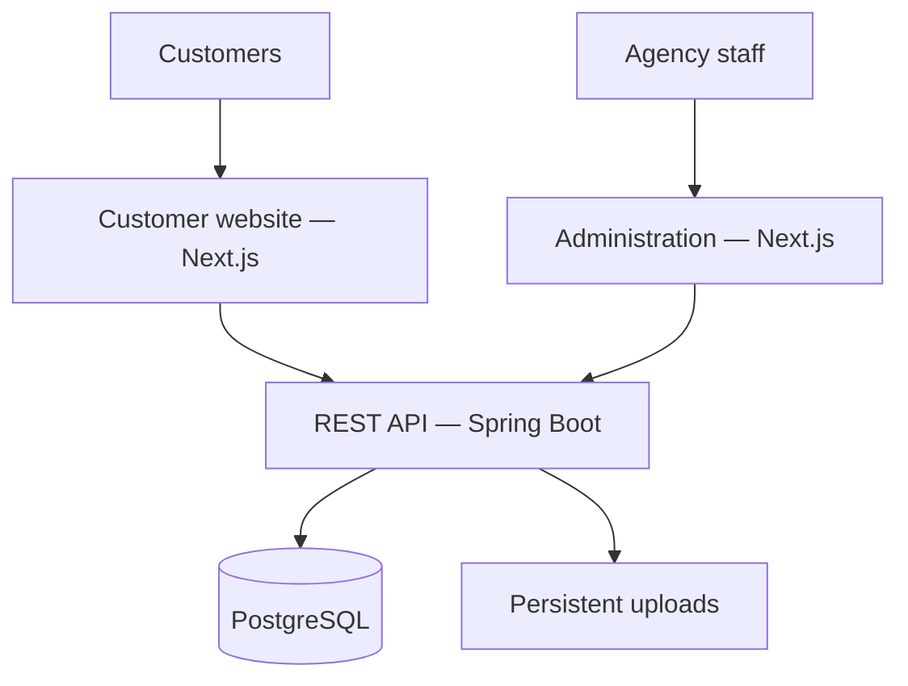

# Ghefou Cars — Car Rental Platform

A freelance project developed for a car rental agency in Morocco,
combining a multilingual customer website, an administration application,
and a Spring Boot REST API.

**Role:** Full Stack & DevOps Developer  
**Status:** Deployed to production  
**Source code:** Private — this repository presents the project.

## Business goals

- Help customers browse available vehicles and submit reservation requests.
- Give the agency a central workspace to manage its rental operations.
- Support communication between customers and the agency.

## Customer website

- Responsive interface in French, English and Arabic, including RTL support.
- Vehicle catalogue, filters, photo galleries and rental date selection.
- Reservation request flow and customer profiles.
- Email/password and Google authentication.
- Customer chat, reviews and Web Push notifications.
- Installable Progressive Web App with light and dark themes.

## Administration

- Dashboard with financial and operational summaries.
- Vehicle, customer and reservation management.
- Contracts, payments, maintenance and delivery/return tracking.
- Customer messages, reviews and notifications.
- Website hero configuration and visitor analytics.

## Technical stack

| Layer | Technologies |
|---|---|
| Customer website | Next.js, React, TypeScript, Tailwind CSS |
| Administration | Next.js, React, TypeScript |
| API | Java, Spring Boot, Spring Security, REST |
| Database | PostgreSQL |
| Authentication | JWT sessions, Google Identity Services |
| Infrastructure | Docker, Docker Compose, Linux VPS, Nginx, HTTPS |
| CI | GitHub Actions, GitHub Container Registry |

## Architecture

## My contribution

- Translated business needs into customer and administration workflows.
- Developed the frontend applications and backend API.
- Implemented authentication, reservations, messaging and notifications.
- Prepared containerized production deployment and persistent storage.
- Configured Nginx, HTTPS and service health checks.
- Set up separate CI workflows for the backend and both frontends.

## Delivery workflow

Pull requests run checks for the affected services. After merging to
the main branch, GitHub Actions builds and publishes versioned Docker
images to GitHub Container Registry.

Deployment to the VPS is currently manual, using immutable image
digests. Each service can be updated independently when changes are
compatible.

## Selected implementation challenges

- Keeping date/time pickers usable inside reservation dialogs on mobile.
- Supporting French, English and Arabic layouts.
- Reducing image transfer sizes with responsive WebP assets.
- Preserving uploaded files across container replacements.
- Configuring visitor country detection behind reverse proxies.

## Repository scope

This repository contains project documentation and selected screenshots.
Application source code, credentials and customer data are not included.
